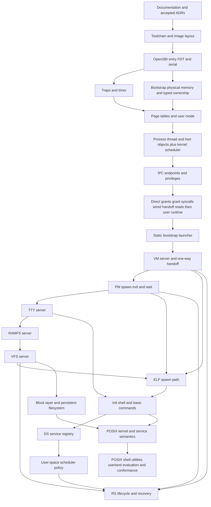

# Development Dependency DAG

## Why this graph exists

The stable runtime architecture of a microkernel system is cyclic. For
example, process creation may involve PM, VFS, and VM; service recovery may
involve nearly every core server. A cyclic runtime graph cannot be used as an
implementation order.

This document defines a separate development graph. Each edge means that the
predecessor must have a tested, stable interface before work starts on the
successor. Bootstrap substitutions intentionally break the runtime cycles.

## Graph

The graph deliberately serializes the first implementation even where some
engineering work could be performed independently. This keeps reviews and
failures attributable to one coherent change.

ADR-0080 adds a certification gate without changing runtime dependencies.
All B01-B14 units in the pinned complete-audit contract are reviewed
sequentially and read-only before any correction or feature implementation.
The accepted
[consolidated findings register and correction DAG](../research/minix-complete-baseline-findings-and-correction-dag.md)
then executes correction design/implementation pairs one at a time in its
preferred dependency order. Step 15 implementation remains blocked through
`BASE01`; Step 16 and ordinary feature work remain blocked through
`RECERT01`.

EV01-EV03 are separately merged. The
[EV04 re-certification record](../research/evidence-foundations-recertification.md)
opens the evidence barrier only after current-candidate validation,
independent review and its acceptance merge. It changes no runtime edge and
does not accept the separately blocked hosted-CI implementation.

The [validation feedback prerequisite](validation-feedback.md), Accepted
under ADR-0105, interrupted the uncommitted MEM03 implementation after
measured repeated evidence verification made the native loop impractical.
Its sequential design #217 and implementation #218 are now separately merged,
and the fresh MEM03 restart independently completed acceptance and merged as
#219. The archived attempts were not borrowed. These outcomes preserve real
target and cross-service acceptance; hosted CI and node Q remain separate
blocked work.

MEM04 design then found missing granular identities for MEM03's existing
native-source checks. Accepted
[EV01-C05](selected-ownership-native-source-authority.md) is a separate
documentation-first evidence prerequisite. Separate design #220 and
independently reviewed implementation #221 are now merged.
The Accepted [MEM04 selected-operation contract](selected-user-address-space.md)
has completed independent design review and separately merged as #222.
The first uncommitted implementation was archived for the
[MEM04-C01 successful-output prerequisite](qemu-runner-source-organization.md#mem04-c01-accepted-transcript-reporting).
Separate design #223 and independently reviewed implementation #224 are now
merged. The fresh restart exposed an indirect handoff error dependency and
is also archived without Green or retirement.
[Accepted ADR-0109](../adr/0109-handoff-preflight-error-ownership.md) has clean
independent design review and separately merged as #225. The subsequent
candidate completed actual Green and recertification but its full stack gate
rejected the new ordinary public declaration at the old whole-header guard.
The candidate is archived.
[Accepted ADR-0110](../adr/0110-kernel-visitor-extension-admission.md) has clean
independent correction review and separately merged as #226.
It covers both the exact header extension and the five callback-free mapping
helpers rejected by the following historical-function boundary.
The fresh candidate passed actual native/target Green and current visitor
binding, then an early stack check rejected the ordinary TTY inspector
prototype at the fatal source-unit guard. The candidate is archived.
[Accepted ADR-0111](../adr/0111-fatal-tty-header-extension.md) has clean
independent design review and separately merged as #227. MEM04 restarts
from that main with a fresh base and three immutable stack-admission inputs.
Its five selected-operation migrations and explicit
twenty-row residual-audit ledger preserve downstream task ownership.
The 59-node runtime graph, finding ownership and MEM04's MEM02/MEM03 runtime
prerequisites do not change.

The fresh MEM04 implementation has completed those gates and independently
merged as #228. MEM05 is next in the preferred runtime order, but its
read-only source census found missing individual MEM04 assertion identities.
[Accepted ADR-0112](../adr/0112-granular-selected-address-space-native-source-authority.md)
and [EV01-C06](selected-address-space-native-source-authority.md) define a
separate metadata-only prerequisite. MEM05 design remains blocked and its
implementation pending until that reviewed design/implementation pair
merges. No runtime edge, finding owner or hosted-CI acceptance changes.
The prerequisite design separately merged as #229 after clean independent
correction and Acceptance review. Its metadata implementation completed
full current acceptance, clean independent review and separate merge as #230.
Journal-free committed/main authority and exact completed-ref cleanup passed.

Resumed MEM05 research then found a distinct
[MEM03 observation-authority gap](../research/selected-ownership-observation-authority-gap.md).
[Accepted ADR-0113](../adr/0113-granular-selected-ownership-observation-authority.md)
and [EV01-C07](selected-ownership-observation-authority.md) define the
120-function metadata prerequisite. Its design is the sole active outcome;
MEM05 design is blocked until that separate pair merges.
No runtime edge, finding owner, algorithm or hosted-CI acceptance changes.
The complete and Acceptance-only design reviews are now clean, and design
#231 is separately merged. Its metadata implementation is the sole active
outcome; MEM05 design remains blocked until its current acceptance and
independently reviewed implementation merge.
Implementation #232 has completed those gates and separately merged,
including journal-free main authority and protected completed-ref cleanup.
MEM05 design has resumed on that current main.
Its [fixed-source study](../research/minix-selected-release-and-wired-handoff.md)
and [Accepted contract](selected-release-and-wired-handoff.md) keep the
exact source, failure and evidence scope explicit.
Complete independent design/correction review is clean.
Design #233 has separately merged. Its implementation preparation stopped
before production edits or formal Red at the
[same-slot count-evidence conflict](selected-release-and-wired-handoff.md#mem05-c01-count-evidence-scope).
The documentation-only MEM05-C01 correction under
[Accepted ADR-0115](../adr/0115-selected-count-generation-evidence-scope.md)
separately merged as #234. It changes no runtime node or edge.
The fresh implementation then reached the
[MEM05-C02 handed-off fixture conflict](selected-release-and-wired-handoff.md#mem05-c02-handed-off-corruption-fixture-coherence).
The candidate is archived without Green or retirement.
[Accepted ADR-0116](../adr/0116-handed-off-leaf-fixture-coherence.md)
has clean complete and Acceptance-only design review and separately merged
as #235. The fresh MEM05 implementation is the sole active outcome and
follows its [evidence map](selected-release-and-wired-handoff.md#implementation-and-evidence-map).
Its one additional frozen target owner changes no runtime dependency,
finding owner or hosted-CI acceptance.

MEM05 implementation #236 has now passed complete current acceptance and
independent review, separately merged, and preserved journal-free
committed/main authority with exact publication-tree equality and protected
ref cleanup. OBJ01 is next in the preferred correction order; its actual
MEM04 prerequisite is already merged. VM02 remains later in that order.
The read-only OBJ01 census found the
[MEM05 current-source authority gap](../research/selected-release-handoff-native-source-authority-gap.md).
[Accepted ADR-0117](../adr/0117-granular-selected-release-handoff-native-source-authority.md)
and [EV01-C08](selected-release-handoff-native-source-authority.md) define
one separate metadata-only prerequisite. Its design is the sole active
outcome; OBJ01 design is blocked and its implementation pending until that
separate pair merges. No runtime edge, finding owner or hosted-CI
acceptance changes.

EV01-C08 design #237 has now separately merged after clean complete
correction and Acceptance-only reviews. Its
[metadata implementation](selected-release-handoff-native-source-authority.md#implementation-map)
is the sole active outcome. OBJ01 design remains blocked until complete
current acceptance, independent review and that implementation merge.
The runtime graph and finding ownership do not change.

EV01-C08 implementation #238 has now completed full current acceptance,
independent review, exact-tree publication and journal-free main checks.
OBJ01 research resumed, then found the separate
[object and panic source-authority gap](../research/object-and-panic-source-authority-gap.md).
[Accepted ADR-0118](../adr/0118-precise-object-and-panic-source-authority.md)
and [EV01-C09](object-and-panic-source-authority.md) define its bounded
metadata prerequisite. Only that design is active; its implementation and
OBJ01 implementation remain pending, and OBJ01 design is blocked until
the prerequisite pair merges. No runtime node, edge, finding owner or
hosted-CI acceptance changes.

EV01-C09 design #239 has now separately merged after clean correction
and Acceptance-only reviews. Its
[metadata implementation](object-and-panic-source-authority.md#implementation-map)
is the sole active outcome. OBJ01 design remains blocked until complete
current acceptance, independent review and that implementation merge.
The runtime graph and finding ownership remain unchanged.

EV01-C09 implementation #240 has now passed complete current acceptance,
independent review, exact-tree publication and journal-free main checks.
OBJ01 design resumes under
[Accepted ADR-0119](../adr/0119-selected-object-and-hart-validation.md) and
the [selected object/hart contract](selected-object-and-hart-validation.md).
It owns only B03-F001/F003/F004; OBJ02, IPC01 and later corrections remain
separate. The design is the sole active outcome and its implementation is
pending separate review, Acceptance and merge. No runtime edge changes.

OBJ01 design #241 has now separately merged. Its uncommitted implementation
is archived after complete native acceptance found an active validator-file
identity missing from the ninety-four-key plan and two historical/current
fixture conflicts. [Accepted ADR-0120](../adr/0120-obj01-complete-source-authority.md)
and [OBJ01-C01](selected-object-and-hart-validation.md#obj01-c01-complete-source-authority)
are the sole active corrective design. The accepted ninety-five-key closure
keeps the same thirty-eight candidate paths and runtime contract.
OBJ01 implementation stays blocked until that design's separate reviewed
merge, then restarts from current `main`. No runtime node, edge, finding owner
or hosted-CI acceptance changes.

Corrective design #242 has now independently merged. OBJ01 implementation
has restarted from that current `main` as the sole active outcome, following
its [implementation map](selected-object-and-hart-validation.md#implementation-and-evidence-map).
The archived attempt supplies no current author event. OBJ02 and later
corrections remain pending; the runtime graph and finding owners are unchanged.

The Accepted [ADR-0087](../adr/0087-phase-bounded-vm-load-temporaries.md)
prerequisite repair is confined to EV03's demonstrated VM automatic-storage
overlap. After separate design merge, that one phase-lifetime edit may
accompany the restarted evidence implementation; it does not start a
runtime correction node, retire a B07 finding, or change this graph.

## Cycle-breaking substitutions

| MINIX runtime cycle | Initial `micros` substitution | Later transition |
| --- | --- | --- |
| Kernel and VM depend on each other | Kernel bootstrap allocator, typed ownership ledger, and static mappings | One-way VM ownership handoff |
| RS coordinates VM, PM, scheduler, and services | Static manifest plus bootstrap launcher | RS adopts the stable service protocol (`SOM-01`) |
| PM, VFS, and VM coordinate fork/exec | PM-directed `spawn` transaction | Add `exec`, then `fork` and copy-on-write (`SOM-06`) |
| VFS, filesystem servers, drivers, and DS discover each other | Fixed RAMFS endpoint and static mount | DS publication and dynamic drivers (`SOM-01`, `SOM-03`) |
| Kernel scheduler mechanism calls user scheduling policy | Kernel round-robin policy | User scheduler receives policy events (`SOM-02`) |
| File-backed VM calls VFS while VFS calls VM | Resident anonymous memory and RAMFS executable reads | Explicit asynchronous file-backed mapping protocol (`SOM-04`) |

## Topological implementation sequence

| Step | Deliverable | Required proof before the next step |
| --- | --- | --- |
| 1 | Documentation and ADR package | Decisions reviewed; DAG and scope internally consistent |
| 2 | Toolchain, linker layout, QEMU launch | Reproducible ELF build and deterministic QEMU exit |
| 3 | OpenSBI entry, FDT, UART, panic | Memory and reservations parsed; boot marker and panic diagnostics visible |
| 4 | Traps, timer, bootstrap allocator, typed frame ownership | Expected exception recovery, timer ticks, allocator/owner invariants, and atomic handoff classification |
| 5 | Page tables, process/thread/hart objects, user mode | U-mode isolation and repeated thread context switches |
| 6 | Scheduler, endpoints, IPC | Blocking, wakeup, reply-token, stale endpoint, privilege, and deadlock tests |
| 7 | Grants, grant syscalls, wired handoff reads, then user runtime | First prove real U-mode grant lifecycle and copies before and after handoff for wired service pages; then prove one standalone freestanding ELF, startup path, raw `ecall`, and C wrappers for operations 1 through 10 |
| 8 | Bootstrap launcher | Immutable manifest validation, deterministic topology, held-image preparation, exact profile/publication release, token-bound readiness, internal timeout failure, and irreversible authority revocation verified |
| 9 | VM handoff | Frame ownership is disjoint and the VM working set remains wired |
| 10 | PM | PM identity, hidden process reservation, spawn metadata, exit, wait, and failure rollback verified |
| 11 | TTY | Two-phase console handoff, deferred PLIC completion, input, and output verified |
| 12 | RAMFS | Directory, file, and direct VFS-facing grant protocol tests pass |
| 13 | VFS | Descriptor, console binding, pathname, mount, routing, and complete two-hop I/O verified |
| 14 | ELF spawn path | A bounded dynamic application loads, activates, exits, waits, rolls back failed spawn, and returns to the post-init resource baseline |
| 15 | Init and shell | Structural/algorithmic parity is certified; instruction synchronization remains valid and the shell runs the required commands |
| 16 | DS, scheduler server, RS | Discovery and injected service recovery verified |
| 17 | Block layer and persistent filesystem | Durable file data, metadata, crash boundaries, and file-backed VM interfaces pass |
| 18 | POSIX kernel and service semantics | Process/thread, signal, credential, terminal, time, memory, IPC, and networking matrices pass |
| 19 | POSIX shell, utilities, and userland evaluation | Mandatory shell/utility behavior passes; any reused userland has accepted provenance |
| 20 | Complete POSIX conformance | Every unconditional mandatory row, every applicable conditionally mandatory row, and every claimed optional/XSI group has executable evidence |

Steps 17 through 20 are the internal sequence of graph nodes U, V, and W.
They do not add parallel work or another runtime dependency edge.

Step 7 is internally serialized even though it is one graph node:

1. endpoint and IPC mechanisms;
2. direct-grant identity and lifetime;
3. checked copies;
4. wired post-handoff address-space reads;
5. the unified operations 1 through 10;
6. the freestanding user-service runtime.

The runtime is not complete merely because the kernel ABI is callable from a
test payload. It requires an independent user ELF, loader/BSS/stack contract,
ABI-preserving raw stub, typed C wrappers, and target acceptance. The static
launcher remains blocked until that complete runtime outcome is reviewed and
implemented.

Step 8 is also internally serialized:

1. validate the pointer-free manifest, immutable profile identities, generated
   image catalog, resource bounds, explicit prerequisites, and cycle-free
   lowest-ID topological order;
2. prepare every static process, root, image, stack, first thread, context,
   reserved endpoint, and held scheduling policy before launcher entry;
3. run only the launcher with its exact profile and active endpoint;
4. atomically install one service's exact profile, publish its endpoint, arm
   one guest-owned readiness deadline, and release its prepared thread;
5. accept one exact-generation readiness call and acknowledge it through the
   request's one-shot reply token;
6. repeat only after the previous service is ready; and
7. hold the launcher, clear the exact controller binding, and irreversibly
   seal bootstrap authority; its retained endpoint and profile remain inert
   until later teardown.

The initial static service chain is launcher, VM, PM, TTY, RAMFS, and VFS.
The Step 8 implementation uses test-only probe ELFs and does not implement
those service protocols. VM readiness is extended at Step 9 so the generic
ready call follows the ownership commit. TTY readiness is extended at Step 11
so release follows `console_handoff_begin` and readiness follows
`console_handoff_commit`.

Step 9 is internally serialized:

1. define and validate the fixed pointer-free VM boot-information/frame-state
   object;
2. atomically stage every static `PROCESS_USER` frame as `VM_WIRED`;
3. patch and read back the exact VM object before launcher publication;
4. start the real VM service and independently validate its frame database;
5. accept one exact VM-only scalar summary operation;
6. commit the irreversible ownership phase;
7. return to VM through post-handoff wired authority;
8. accept VM's ordinary launcher readiness only after that commit; and
9. prove the launcher can seal while VM remains wired.

Step 9 does not add dynamic mapping or non-VM page-fault delivery. Those
interfaces require a later reviewed mapping authority before PM or executable
loading may consume them.

Step 10 is internally serialized:

1. define the PM application table, semantic PID, parent/child, init-reaper,
   exit, zombie, and wait contracts;
2. add the exact PM bootstrap role and profile, the stable inert
   `APPLICATION` profile identity, and PM readiness;
3. inject one kernel-origin event when launcher authority is irreversibly
   sealed;
4. reserve and abort one hidden empty kernel process through exact PM-only
   authority;
5. prove the complete future spawn transaction and reverse rollback order in a
   native transition model;
6. prove versioned exit/wait decoding and malformed-client rejection; and
7. run one real PM service after VM handoff without creating a dynamic child.

The Step 10 reservation has no root, thread, endpoint, profile, mapping,
grant, scheduler state, or process-owned frame. It preserves the process slot
needed by a later transaction but cannot be published or run.

Step 10 does not add a successful spawn path, dynamic mapping, executable
loading, descriptor state, or running-process target teardown. Step 14 adds
those integrations only after VM, PM, TTY, RAMFS, and VFS are all
dependency-ready. At that point, VM creates and freezes mappings for the
reserved process; PM's prepare transition creates the first thread and
reserved endpoint, installs `APPLICATION`, attaches the executable context,
and seals the mapping generation before final activation.

Step 11 is internally serialized:

1. fix the local MINIX TTY, grant, buffering, MMIO, notification, and explicit
   IRQ-acknowledgment baseline;
2. prepare one exact launcher/VM/TTY console binding and keep UART source 10
   disabled;
3. begin handoff, arm one manifest-bounded deadline, disable ordinary kernel
   output, and notify VM while TTY remains held;
4. let exact VM authority install only the fixed UART leaf at `0x7fffe000`
   without allocation or page-table growth;
5. notify the launcher from the kernel after that PTE commits, then release
   TTY;
6. initialize the NS16550A, drain stale state, commit ownership, install the
   PLIC route, and only then accept TTY readiness;
7. claim source 10, notify exact TTY, retain it in service, and complete it
   only after TTY drains the device;
8. prove bounded canonical input, interrupt-driven output, exact grants,
   cancellation, completion and writable notifications, lost-wakeup
   prevention, and malformed-request rejection in native models; and
9. run one real QEMU TTY scenario with deterministic host input and no sleeps.

Step 11's post-handoff mapping is a one-shot device exception. It does not add
ordinary frames, map/unmap selection, page-table growth, page faults, scratch
aliases, or the Step 14 executable-mapping transaction.

Step 12 is internally serialized:

1. fix the local MINIX VFS, libfsdriver, MFS mount, lookup, create, mkdir,
   read/write, getdents, and putnode baseline;
2. define one reproducible pointer-free seed image and fixed BSS node, block,
   path, name, file, transfer, and directory-record bounds;
3. add generation-safe node identity, exact link/reference ownership, root
   confinement, sparse-file semantics, and failure-atomic mutation in native
   tests;
4. define and model exact VFS-only mount, lookup, create, mkdir, read, write,
   getdents, and putnode calls with directional one-page grants;
5. run one replayable mixed RAMFS model that compares complete production and
   independent reference state after every operation;
6. add the exact RAMFS/VFS profile relationships, real RAMFS seed
   initialization, readiness, and single-threaded service loop;
7. run one six-service QEMU scenario with the real launcher, VM, PM, TTY, and
   RAMFS plus an exact test VFS peer; and
8. prove seed validation, one mount, path lookup, writable sparse data,
   complete-record cursors, balanced references, checked grants, and clean
   launcher sealing.

Step 12 does not add production VFS descriptors, application I/O, unlink,
rename, truncate, block storage, executable loading, init, or shell behavior.
Those remain at their later DAG nodes.

Step 13 is internally serialized:

1. fix the local MINIX VFS caller, process, descriptor, open-file, vnode,
   pathname, character-device, directory-record, and exit-cleanup baseline;
2. add one non-copying grantee-only grant-range preflight so a consuming
   second hop cannot lose terminal input on an invalid application
   destination, and atomically move manifest storage, service configuration,
   and VM boot information to their exact capacity-seven layouts;
3. define fixed process, descriptor, open-file, vnode, root/cwd, bounce-page,
   directory-record, and asynchronous-operation bounds;
4. implement and model exact application open, close, read, write, getdents,
   mkdir, and chdir calls;
5. mount RAMFS once, aggregate backend references, and bind trusted process
   descriptors 0, 1, and 2 to one synthetic console object;
6. compose TTY submit, completion, collection, cancellation, and writable
   retry without blocking VFS's receive loop;
7. run one replayable mixed VFS model that compares complete production and
   independent reference state after every operation; and
8. run one seven-process QEMU scenario with the six real production services
   plus an isolated application probe that proves both grant hops, pathname
   routing, translated directories, console I/O, zero live grants, and clean
   launcher sealing.

The bootstrap object may store seven entries for that isolated fixture, but
the production manifest remains exactly the six-service chain. The probe is
not `init`, cannot call RAMFS or TTY, and does not implement production spawn.

Step 13 does not add PM/VFS transaction messages, executable buffering,
dynamic mapping, application activation, target exit teardown, seek, truncate,
unlink, rename, named devices, pipes, sockets, block devices, signals, init, or
the shell. Step 14 adds those dependency-ready integrations around the
reviewed VFS state owner.

Step 14 is internally serialized:

1. fix the local MINIX exec, ELF loading, stack construction, kernel
   activation, VFS cleanup, and VM release baseline;
2. define one pointer-free bounded path, argv, envp, and descriptor-action
   request plus a fixed static RISC-V ELF64 subset;
3. promote VM into a production core and add one exact scratch-fill, freeze,
   rollback, and release transaction after handoff;
4. extend PM-only kernel control with token-bound execution preparation,
   activation, exit-begin, execution detach, and empty-process release;
5. add VFS executable buffering, VM-targeted direct grants, hidden descriptor
   preparation, hidden commit, rollback, abort, and image release;
6. decompose the portable VFS implementation into the responsibility modules
   defined by
   [ADR-0051](../adr/0051-responsibility-based-source-modules.md) without
   changing accepted runtime behavior;
7. integrate the exact ADR-0050 exit transaction: PM commits and retains the
   `EXITING` record and exit token, VFS cancels pending TTY work and releases
   descriptors and vnode references, the kernel detaches endpoint, grant,
   scheduler, reply, profile, and thread authority, VM destroys the address
   space, the kernel releases the empty process slot, and only then PM
   publishes the zombie and completes affected-parent wait discovery;
8. add one separate argv/env application startup path and normal-return exit;
9. prove every preactivation rollback stage and both affected-parent
   exit/wait sets in native state models and kernel component tests;
10. run one isolated QEMU component that preempts VM between scratch map and
   commit, activates another Sv39 root, reactivates VM, and proves the removed
   scratch translation cannot remain usable; and
11. run one QEMU fixture whose dynamic PID 1 forces a post-freeze spawn
   rollback, spawns one child, verifies argv/env and inherited descriptors,
   waits for its exit status, and returns all child resources to baseline.

The repository source-module audit adds behavior-preserving maintenance gates
to this sequence without changing the runtime dependency graph:

- the VFS test-source decomposition defined by
  [ADR-0052](../adr/0052-vfs-test-source-decomposition.md) must merge before
  item 7 adds exit-cleanup coverage to the currently signaled VFS test files;
  and
- the kernel address-space and execution-family decomposition proposed by
  [ADR-0053](../adr/0053-kernel-address-space-source-decomposition.md) and
  defined by the
  [kernel address-space source-organization contract](kernel-address-space-source-organization.md),
  followed by the frame-ownership and kernel VM-handoff corrections, the
  [kernel PM-control source-organization contract](kernel-pm-control-source-organization.md),
  the [VM service source-organization contract](vm-service-source-organization.md),
  and the PM-service correction defined by
  [ADR-0058](../adr/0058-pm-service-source-decomposition.md) and its exact
  [PM service source-organization contract](pm-service-source-organization.md),
  must merge before the cross-service
  coordinator composes the remaining spawn and exit transaction.

The exact correction units and paired task IDs are recorded in
[the repository source-module audit](source-module-audit.md). They remain
sequential, behavior-preserving tasks rather than one broad Step 14 rewrite.
The selected [ELF checker tooling correction](user-elf-checker-source-organization.md)
also precedes the host application checker in item 8: existing parsing and
structural validation acquire explicit owners before reuse, without
duplicating service policy or changing this runtime graph. Accepted
ADR-0063's design #125 and implementation #126 are merged. The checked
application runtime #127 is also merged; the final
[dynamic PID-1 integration](elf-spawn-integration.md) now composes the
production mechanisms without changing this runtime graph.
The separately reviewed
[kernel IPC correction](kernel-ipc-source-organization.md) applies the audit's
before-next-touch rule to existing Step 6/7 mechanisms. It does not change
this runtime graph or add an unrelated coordinator prerequisite.

The Step 14 PID-1 program is an isolated integration fixture, not production
init. It proves the production spawn, loader, application-runtime, exit, and
wait mechanisms without combining them with shell policy or commands.

`init` is not a static manifest service. Step 15 creates production init
through the reviewed ADR-0009 PM/VFS/VM spawn transaction after launcher
authority is sealed, then adds the shell and required commands.

Step 15 is internally serialized:

1. fix the local MINIX init, shell, foreground execution, echo, cat, ls and ps
   baseline;
2. define one shared canonical spawn-request builder and bounded
   application-client layer;
3. persist a bounded PM command display name and publish one read-only
   application-process snapshot for `ps`;
4. spawn production PID 1 exactly once from PM after bootstrap sealing;
5. make init spawn, wait for and restart one console shell;
6. implement the bounded simple-command shell and four separate command
   applications;
7. build one immutable checked userland seed; and
8. prove exact serial output, command PIDs, shell reaping, post-init resource
   equality, UART drain and clean SBI shutdown.

Step 15 does not add fork, signals, sessions, login, getty, multiple terminals,
full shell grammar, pipes, redirection, background jobs, static-service
enumeration in `ps`, or production shutdown authority.

## Phase gates

### Mechanism gate

Before the first user server, the kernel must demonstrate:

- user/supervisor memory isolation;
- preemption;
- distinct process, thread, endpoint, and hart objects;
- repeatable context switching;
- generation-aware endpoint rejection;
- exact reply-token matching to a blocked thread;
- IPC permission enforcement;
- finite deadlock-chain detection;
- bounded direct grants.

### Runtime gate

Before the static launcher, the user runtime must demonstrate:

- one standalone fixed-address ELF with exact RX, R, and RW/NX closure;
- loader-owned BSS zeroing and an external aligned writable stack;
- a C-ABI-preserving raw `ecall` boundary;
- typed wrappers for every stable operation 1 through 10;
- exact stable results without `errno`;
- no relocation, hosted libc, heap, TLS, constructors, arguments, or service
  readiness policy.

### Service gate

Before executable loading, VM, PM, TTY, RAMFS, and VFS must each:

- start from the static launcher;
- perform one exact-generation, versioned readiness call and receive its
  token-bound acknowledgment;
- reject malformed requests;
- survive ordinary client termination without leaking owned state;
- expose enough diagnostics to identify the current request and peer endpoint.

### Shell MVP gate

The first MVP is complete when a clean build boots under QEMU and an automated
serial session can:

1. observe the init and shell readiness markers;
2. run `echo`;
3. read a seeded RAMFS file with `cat`;
4. list a directory with `ls`;
5. list processes with `ps`;
6. terminate a child and collect it through `wait`;
7. shut down QEMU with a successful test result.

## Rules for changing the graph

- A new predecessor requires an ADR or a documented correction to an existing
  dependency.
- A runtime cycle must not be introduced into the development graph.
- Work on a successor does not begin while its predecessor pull request is
  awaiting review.
- Deferred components cannot be pulled into the shell MVP merely to emulate
  MINIX more closely.
