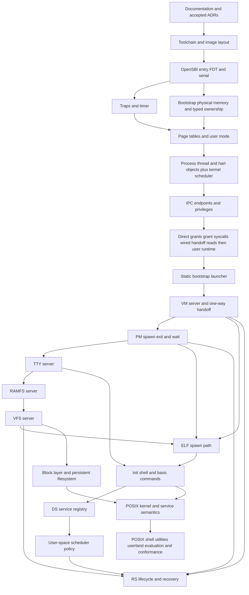

# Development Dependency DAG

## Why this graph exists

The stable runtime architecture of a microkernel system is cyclic. For
example, process creation may involve PM, VFS, and VM; service recovery may
involve nearly every core server. A cyclic runtime graph cannot be used as an
implementation order.

This document defines a separate development graph. Each edge means that the
predecessor must have a tested, stable interface before work starts on the
successor. Bootstrap substitutions intentionally break the runtime cycles.

## Graph

The graph deliberately serializes the first implementation even where some
engineering work could be performed independently. This keeps reviews and
failures attributable to one coherent change.

## Certification overlay

The completed [B01-B14 audit and correction register](../research/minix-complete-baseline-findings-and-correction-dag.md)
adds a certification gate without changing the runtime edges above.
Its current-progress table and preferred order own correction readiness;
this graph does not repeat their PR history.

Step 15 remains blocked through `BASE01`; Step 16 and ordinary feature work
remain blocked through `RECERT01`. B04-F005 retains its post-node SOM-24
replacement point. A ready graph node is not permission to develop another
task in parallel.

The [current validation contract](current-contract-validation.md) removes
historical metadata-only prerequisites and duplicate author ceremonies,
not runtime dependencies, accepted finding ownership or required evidence.
Hosted CI has no additional runtime-DAG edge.

## Cycle-breaking substitutions

| MINIX runtime cycle | Initial `micros` substitution | Later transition |
| --- | --- | --- |
| Kernel and VM depend on each other | Kernel bootstrap allocator, typed ownership ledger, and static mappings | One-way VM ownership handoff |
| RS coordinates VM, PM, scheduler, and services | Static manifest plus bootstrap launcher | RS adopts the stable service protocol (`SOM-01`) |
| PM, VFS, and VM coordinate fork/exec | PM-directed `spawn` transaction | Add `exec`, then `fork` and copy-on-write (`SOM-06`) |
| VFS, filesystem servers, drivers, and DS discover each other | Fixed RAMFS endpoint and static mount | DS publication and dynamic drivers (`SOM-01`, `SOM-03`) |
| Kernel scheduler mechanism calls user scheduling policy | Kernel round-robin policy | User scheduler receives policy events (`SOM-02`) |
| File-backed VM calls VFS while VFS calls VM | Resident anonymous memory and RAMFS executable reads | Explicit asynchronous file-backed mapping protocol (`SOM-04`) |

## Topological implementation sequence

| Step | Deliverable | Required proof before the next step |
| --- | --- | --- |
| 1 | Documentation and ADR package | Decisions reviewed; DAG and scope internally consistent |
| 2 | Toolchain, linker layout, QEMU launch | Reproducible ELF build and deterministic QEMU exit |
| 3 | OpenSBI entry, FDT, UART, panic | Memory and reservations parsed; boot marker and panic diagnostics visible |
| 4 | Traps, timer, bootstrap allocator, typed frame ownership | Expected exception recovery, timer ticks, allocator/owner invariants, and atomic handoff classification |
| 5 | Page tables, process/thread/hart objects, user mode | U-mode isolation and repeated thread context switches |
| 6 | Scheduler, endpoints, IPC | Blocking, wakeup, reply-token, stale endpoint, privilege, and deadlock tests |
| 7 | Grants, grant syscalls, wired handoff reads, then user runtime | First prove real U-mode grant lifecycle and copies before and after handoff for wired service pages; then prove one standalone freestanding ELF, startup path, raw `ecall`, and C wrappers for operations 1 through 10 |
| 8 | Bootstrap launcher | Immutable manifest validation, deterministic topology, held-image preparation, exact profile/publication release, token-bound readiness, internal timeout failure, and irreversible authority revocation verified |
| 9 | VM handoff | Frame ownership is disjoint and the VM working set remains wired |
| 10 | PM | PM identity, hidden process reservation, spawn metadata, exit, wait, and failure rollback verified |
| 11 | TTY | Two-phase console handoff, deferred PLIC completion, input, and output verified |
| 12 | RAMFS | Directory, file, and direct VFS-facing grant protocol tests pass |
| 13 | VFS | Descriptor, console binding, pathname, mount, routing, and complete two-hop I/O verified |
| 14 | ELF spawn path | A bounded dynamic application loads, activates, exits, waits, rolls back failed spawn, and returns to the post-init resource baseline |
| 15 | Init and shell | Structural/algorithmic parity is certified; instruction synchronization remains valid and the shell runs the required commands |
| 16 | DS, scheduler server, RS | Discovery and injected service recovery verified |
| 17 | Block layer and persistent filesystem | Durable file data, metadata, crash boundaries, and file-backed VM interfaces pass |
| 18 | POSIX kernel and service semantics | Process/thread, signal, credential, terminal, time, memory, IPC, and networking matrices pass |
| 19 | POSIX shell, utilities, and userland evaluation | Mandatory shell/utility behavior passes; any reused userland has accepted provenance |
| 20 | Complete POSIX conformance | Every unconditional mandatory row, every applicable conditionally mandatory row, and every claimed optional/XSI group has executable evidence |

Steps 17 through 20 are the internal sequence of graph nodes U, V, and W.
They do not add parallel work or another runtime dependency edge.

### Internal sequencing and owning contracts

The steps above remain sequential even when an outcome needs several PRs.
Detailed state transitions belong to their contracts, not another copy in
this graph:

| Step | Required internal order and source of truth |
| --- | --- |
| 7 | Endpoint/IPC -> grant identity/lifetime -> checked copies -> wired post-handoff reads -> unified operations 1-10 -> [standalone service runtime](../adr/0042-freestanding-user-service-runtime.md). A callable test payload is not runtime completion. |
| 8 | Validate manifest -> prepare all held static images -> run launcher only -> exact profile/endpoint/scheduler release -> token-bound ready acknowledgment -> next dependency -> irreversible seal. [Bootstrap contract](../adr/0043-static-bootstrap-launcher.md). |
| 9 | Build and validate the pointer-free database -> stage wired owners -> VM independently validates -> exact VM-only handoff commit -> post-handoff return -> VM ready -> launcher seal. [VM contract](../adr/0045-static-vm-bootstrap-and-handoff.md). No general mapping or non-VM fault protocol is implied. |
| 10 | PM identity/lifecycle model -> bootstrap-sealed gate -> exact empty process reserve/abort -> protocol/rollback evidence. Successful dynamic spawn waits for step 14. [PM contract](../adr/0046-pm-process-lifecycle-and-spawn-metadata.md). |
| 11 | Console begin/deadline -> VM installs fixed device leaf -> TTY release/init -> console commit -> ready -> retained PLIC claim -> explicit TTY completion. [TTY contract](../adr/0047-tty-console-handoff-and-serial-protocol.md). |
| 12 | Seed validation -> generation-safe namespace/storage -> VFS-only grant protocol -> independent mixed model -> real RAMFS with test VFS peer. [RAMFS contract](../adr/0048-ramfs-service-and-vfs-filesystem-protocol.md). |
| 13 | Grant destination preflight and capacity-seven ABI -> VFS ownership/namespace/I/O -> RAMFS mount/console binding -> asynchronous TTY completion -> independent model -> seven-process fixture. Production remains six services. [VFS contract](../adr/0049-vfs-service-and-application-io-protocol.md). |
| 14 | Reviewed [post-handoff transaction](../adr/0050-post-handoff-elf-spawn.md), [coordinator](pm-spawn-coordinator.md), [application runtime](application-runtime.md), actual VM scratch-preemption component, then [dynamic PID-1 integration](elf-spawn-integration.md). Test PID 1 is not production init. |
| 15 | `BASE01` -> `NODE00` core -> `NODE01` clients/streaming commands -> `NODE02` snapshot/sort/commands -> `NODE03` integrated shell evidence -> `STACK13` -> `RECERT01`. Exact ownership is in the correction register and [node-Q contract](init-shell.md). |

The [source-module audit](source-module-audit.md) retains its before-next-touch
responsibility rules. Completed decompositions do not create new runtime
edges or require replaying their historical source transport. A new
behavioral/authority decision still needs its own Accepted design.

Later DS, scheduler-server, recovery and storage work follows its actual
graph dependencies; do not invent an edge between independent control-plane
and storage branches merely because execution is serialized.

## Phase gates

### Mechanism gate

Before the first user server, the kernel must demonstrate:

- user/supervisor memory isolation;
- preemption;
- distinct process, thread, endpoint, and hart objects;
- repeatable context switching;
- generation-aware endpoint rejection;
- exact reply-token matching to a blocked thread;
- IPC permission enforcement;
- finite deadlock-chain detection;
- bounded direct grants.

### Runtime gate

Before the static launcher, the user runtime must demonstrate:

- one standalone fixed-address ELF with exact RX, R, and RW/NX closure;
- loader-owned BSS zeroing and an external aligned writable stack;
- a C-ABI-preserving raw `ecall` boundary;
- typed wrappers for every stable operation 1 through 10;
- exact stable results without `errno`;
- no relocation, hosted libc, heap, TLS, constructors, arguments, or service
  readiness policy.

### Service gate

Before executable loading, VM, PM, TTY, RAMFS, and VFS must each:

- start from the static launcher;
- perform one exact-generation, versioned readiness call and receive its
  token-bound acknowledgment;
- reject malformed requests;
- survive ordinary client termination without leaking owned state;
- expose enough diagnostics to identify the current request and peer endpoint.

### Shell MVP gate

The first MVP is complete when a clean build boots under QEMU and an automated
serial session can:

1. observe the init and shell readiness markers;
2. run `echo`;
3. read a seeded RAMFS file with `cat`;
4. list a directory with `ls`;
5. list processes with `ps`;
6. terminate a child and collect it through `wait`;
7. shut down QEMU with a successful test result.

## Rules for changing the graph

- A new predecessor requires an ADR or a documented correction to an existing
  dependency.
- A runtime cycle must not be introduced into the development graph.
- Work on a successor does not begin while its predecessor pull request is
  awaiting review.
- Deferred components cannot be pulled into the shell MVP merely to emulate
  MINIX more closely.
