# Complete MINIX Baseline Findings Register and Correction DAG

## Status

```text
micros audit commit:      da0bd95148f2704d5347c2af4c64085b90132746
micros audit tree:        3b90c7716d69efd68930b3f8ab86a32813bdd6c3
MINIX commit:             4db99f4012570a577414fe2a43697b2f239b699e
audit units:              B01-B14 complete
audited finding records:  80 (55 High, 25 Medium)
pre-node blocking:        79 (54 High, 25 Medium)
post-node staged:         1 (B04-F005 under SOM-24)
correction nodes:         59
correction edges:         155
result:                   consolidated; correction queue defined; baseline not certified
```

This document is the canonical post-audit register required by ADR-0080. It
consolidates each audited finding exactly once and converts the reviewed
finding dependencies into an acyclic correction-task graph. It authorizes no
runtime change by itself. Every finding-owning node still requires its own
documentation-first design pull request, clean independent design review,
separate test-first implementation pull request, and affected-unit
re-certification.

Development remains sequential even where this DAG exposes more than one
ready node. The preferred pre-node order below selects one dependency-ready
task at a time. An out-of-scope discovery becomes a separate task; it never
expands the active pull request.

The post-pin
[EV04 re-certification record](evidence-foundations-recertification.md)
records separately merged EV01 #177, EV02 #179 and EV03 #184. Its acceptance
merge opens the evidence barrier after current-candidate validation and
independent review. These three infrastructure outcomes do not close the
76 pre-node runtime findings or change the frozen counts above. The separate
hosted-CI implementation remains unaccepted; it adds no runtime-DAG edge.

## Consolidation invariants

- All 80 B01-B14 finding records appear exactly once in the register and
  exactly one finding-owning node.
- B04-F005 is an accepted staged substitution under SOM-24. It remains mapped
  to its post-node replacement point and does not block `BASE01` or
  `RECERT01`.
- Barrier, post-node prerequisite, and prerequisite feature nodes own no
  finding.
- Every prerequisite edge points from an earlier requirement to a later
  consumer; the 59-node, 155-edge graph is acyclic.
- `EV01` through `EV04` close the evidence-authority gate before production
  correction work. `EV03` closes current B01-B12 stack proof and installs the
  future B13 admission rule.
  Accepted [ADR-0087](../adr/0087-phase-bounded-vm-load-temporaries.md)
  admits only the demonstrated VM preparation temporary-lifetime repair
  inside EV03 after its separate design merge. It changes no finding
  ownership, node/edge, validation cadence or runtime algorithm; ordinary
  VM01-VM06 work remains behind EV04 and its existing prerequisites.
- `BASE01` requires every pre-node B01-B12 blocking correction branch to be
  merged and affected units re-certified before node-Q implementation.
- `NODE00` through `NODE03` partition core, client/command, snapshot/sort, and
  complete integration outcomes without future-consumer evidence.
- `STACK13` closes B13-E007 only after node-Q production exists.
- `RECERT01` requires the 79 pre-node blocking findings and complete B01-B14
  current-scope evidence to be closed before Step 16 resumes.
- `EXT01` and `IPC05` remain at the SOM-24 manifest-defined post-node
  replacement point.
- Accepted ADRs remain authoritative until the owning correction design
  explicitly supersedes them.

## Consolidated findings register

| Finding | Severity | Disposition | Title | Correction node | Source audit |
| --- | --- | --- | --- | --- | --- |
| `B01-F001` | High | Pre-node blocking | UART polling is unbounded | `PLAT02` | [B01](minix-complete-baseline-b01-platform.md) |
| `B01-F002` | High | Pre-node blocking | The MINIX diagnostic buffers are absent | `PLAT01` | [B01](minix-complete-baseline-b01-platform.md) |
| `B01-F003` | High | Pre-node blocking | Panic has no recursive-entry guard | `PLAT02` | [B01](minix-complete-baseline-b01-platform.md) |
| `B01-F004` | Medium | Pre-node blocking | Panic omits the reference stack trace | `PLAT03` | [B01](minix-complete-baseline-b01-platform.md) |
| `B01-F005` | High | Pre-node blocking | Corrupt console metadata hard-spins before panic output | `PLAT02` | [B01](minix-complete-baseline-b01-platform.md) |
| `B01-F006` | High | Pre-node blocking | Successful bootstrap validation rescans every frame | `MEM01` | [B01](minix-complete-baseline-b01-platform.md) |
| `B02-F001` | High | Pre-node blocking | Bootstrap allocation restarts a per-frame scan | `MEM01` | [B02](minix-complete-baseline-b02-memory.md) |
| `B02-F002` | High | Pre-node blocking | Complete ownership validation is on ordinary valid paths | `MEM03` | [B02](minix-complete-baseline-b02-memory.md) |
| `B02-F003` | High | Pre-node blocking | Kernel bootstrap omits the reference large-page map | `MEM02` | [B02](minix-complete-baseline-b02-memory.md) |
| `B02-F004` | High | Pre-node blocking | Kernel mapping and validation linearly search table frames | `MEM02` | [B02](minix-complete-baseline-b02-memory.md) |
| `B02-F005` | High | Pre-node blocking | Lookup, translation, and root activation run complete validation | `MEM04` | [B02](minix-complete-baseline-b02-memory.md) |
| `B02-F006` | High | Pre-node blocking | Page release and process destruction scan full capacity | `MEM05` | [B02](minix-complete-baseline-b02-memory.md) |
| `B02-F007` | High | Pre-node blocking | Wired handoff repeats the full owner scan per process | `MEM05` | [B02](minix-complete-baseline-b02-memory.md) |
| `B02-F008` | High | Pre-node blocking | VM mapping transactions validate every process root | `VM02` | [B02](minix-complete-baseline-b02-memory.md) |
| `B02-F009` | Medium | Pre-node blocking | VM frame plans use pairwise duplicate searches | `VM02` | [B02](minix-complete-baseline-b02-memory.md) |
| `B03-F001` | High | Pre-node blocking | Complete registry validation precedes ordinary scheduler operations | `OBJ01` | [B03](minix-complete-baseline-b03-objects-scheduler.md) |
| `B03-F002` | High | Pre-node blocking | Common return rebuilds complete queue state | `OBJ02` | [B03](minix-complete-baseline-b03-objects-scheduler.md) |
| `B03-F003` | Medium | Pre-node blocking | Stack-disjointness validation is pairwise | `OBJ01` | [B03](minix-complete-baseline-b03-objects-scheduler.md) |
| `B03-F004` | High | Pre-node blocking | Hot current-hart/thread ownership scans every hart | `OBJ01` | [B03](minix-complete-baseline-b03-objects-scheduler.md) |
| `B03-F005` | High | Pre-node blocking | Common return repeats complete memory/context validation | `OBJ02` | [B03](minix-complete-baseline-b03-objects-scheduler.md) |
| `B03-F006` | High | Pre-node blocking | Deferred IPC completion repeats global validation | `IPC01` | [B03](minix-complete-baseline-b03-objects-scheduler.md) |
| `B04-F001` | High | Pre-node blocking | Complete endpoint/object validation is on every IPC path | `IPC01` | [B04](minix-complete-baseline-b04-endpoint-ipc.md) |
| `B04-F002` | High | Pre-node blocking | Resolution and authorization repeatedly revalidate immutable state | `IPC01` | [B04](minix-complete-baseline-b04-endpoint-ipc.md) |
| `B04-F003` | High | Pre-node blocking | Deadlock projection is quadratic in thread capacity | `IPC02` | [B04](minix-complete-baseline-b04-endpoint-ipc.md) |
| `B04-F004` | High | Pre-node blocking | Reply tokens have no direct binding index | `IPC03` | [B04](minix-complete-baseline-b04-endpoint-ipc.md) |
| `B04-F005` | High | Staged substitution (SOM-24) | Receiver-owned MINIX IPC filters are absent | `IPC05` | [B04](minix-complete-baseline-b04-endpoint-ipc.md) |
| `B04-F006` | Medium | Pre-node blocking | Sender tail indexing is a pre-baseline optimization | `IPC04` | [B04](minix-complete-baseline-b04-endpoint-ipc.md) |
| `B05-F001` | High | Pre-node blocking | Complete grant relation validation precedes ordinary operations | `GRANT01` | [B05](minix-complete-baseline-b05-grants-user-execution.md) |
| `B05-F002` | High | Pre-node blocking | Grant syscalls validate the complete runtime twice | `GRANT01` | [B05](minix-complete-baseline-b05-grants-user-execution.md) |
| `B05-F003` | Medium | Pre-node blocking | Grant allocation replaces the MINIX free list with a full scan | `GRANT02` | [B05](minix-complete-baseline-b05-grants-user-execution.md) |
| `B05-F004` | Medium | Pre-node blocking | Endpoint grant cancellation visits every grant slot | `GRANT02` | [B05](minix-complete-baseline-b05-grants-user-execution.md) |
| `B05-F005` | High | Pre-node blocking | Checked copy commits one byte at a time | `GRANT03` | [B05](minix-complete-baseline-b05-grants-user-execution.md) |
| `B05-F006` | High | Pre-node blocking | Runtime copy and fill are volatile byte loops | `COPY01` | [B05](minix-complete-baseline-b05-grants-user-execution.md) |
| `B06-F001` | Medium | Pre-node blocking | Runtime service lookup and transitions are capacity-linear | `BOOT01` | [B06](minix-complete-baseline-b06-static-bootstrap.md) |
| `B06-F002` | High | Pre-node blocking | Every bootstrap control command runs whole-system validation | `BOOT02` | [B06](minix-complete-baseline-b06-static-bootstrap.md) |
| `B06-F003` | High | Pre-node blocking | Successful commands repeat complete validation before and after commit | `BOOT02` | [B06](minix-complete-baseline-b06-static-bootstrap.md) |
| `B06-F004` | Medium | Pre-node blocking | Bootstrap copy and clear operations are byte loops | `BOOT03` | [B06](minix-complete-baseline-b06-static-bootstrap.md) |
| `B07-F001` | High | Pre-node blocking | Complete kernel and service VM validation precedes ordinary transitions | `VM01` | [B07](minix-complete-baseline-b07-vm.md) |
| `B07-F002` | High | Pre-node blocking | One application load multiplies complete validation per page | `VM03` | [B07](minix-complete-baseline-b07-vm.md) |
| `B07-F003` | High | Pre-node blocking | Frame allocation does not reproduce the MINIX bitmap/cache allocator | `VM04` | [B07](minix-complete-baseline-b07-vm.md) |
| `B07-F004` | High | Pre-node blocking | VM mapping uniqueness is established by pairwise searches | `VM02` | [B07](minix-complete-baseline-b07-vm.md) |
| `B07-F005` | High | Pre-node blocking | VM image/state movement lacks the MINIX word/block copy family | `VM05` | [B07](minix-complete-baseline-b07-vm.md) |
| `B07-F006` | Medium | Pre-node blocking | The kernel permanently reserves a duplicate complete VM snapshot | `VM06` | [B07](minix-complete-baseline-b07-vm.md) |
| `B08-F001` | High | Pre-node blocking | Complete quadratic PM-table validation precedes ordinary operations | `PM01` | [B08](minix-complete-baseline-b08-pm-spawn.md) |
| `B08-F002` | High | Pre-node blocking | One coordinator operation reruns complete PM validation many times | `PM01` | [B08](minix-complete-baseline-b08-pm-spawn.md) |
| `B08-F003` | Medium | Pre-node blocking | PM lacks the MINIX caller index and rotating free-slot cursor | `PM01` | [B08](minix-complete-baseline-b08-pm-spawn.md) |
| `B08-F004` | Medium | Pre-node blocking | Wait selection and cross-parent reply order differ from MINIX | `PM02` | [B08](minix-complete-baseline-b08-pm-spawn.md) |
| `B08-F005` | High | Pre-node blocking | Every operation-13 command validates whole-system PM state | `PM03` | [B08](minix-complete-baseline-b08-pm-spawn.md) |
| `B08-F006` | Medium | Pre-node blocking | PM request and state movement uses byte-at-a-time loops | `PM04` | [B08](minix-complete-baseline-b08-pm-spawn.md) |
| `B09-F001` | High | Pre-node blocking | Complete terminal validation is multiplied per byte and request | `TTY01` | [B09](minix-complete-baseline-b09-tty.md) |
| `B09-F002` | High | Pre-node blocking | Every IRQ dispatch and completion validates whole-system TTY state | `TTY01` | [B09](minix-complete-baseline-b09-tty.md) |
| `B09-F003` | High | Pre-node blocking | The raw receive ring is absent and the PLIC claim spans higher-level work | `TTY01` | [B09](minix-complete-baseline-b09-tty.md) |
| `B09-F004` | High | Pre-node blocking | Output storage changes FIFO order, backpressure, and cancellation | `TTY02` | [B09](minix-complete-baseline-b09-tty.md) |
| `B09-F005` | Medium | Pre-node blocking | Canonical admission reserves a newline slot that MINIX does not | `TTY02` | [B09](minix-complete-baseline-b09-tty.md) |
| `B09-F006` | Medium | Pre-node blocking | Accepted request IDs are globally ordered instead of opaque | `TTY02` | [B09](minix-complete-baseline-b09-tty.md) |
| `B09-F007` | Medium | Pre-node blocking | TTY state movement is byte-serial and accepted writes self-copy | `TTY03` | [B09](minix-complete-baseline-b09-tty.md) |
| `B10-F001` | High | Pre-node blocking | Complete filesystem validation surrounds every ordinary request | `RAM01` | [B10](minix-complete-baseline-b10-ramfs.md) |
| `B10-F002` | High | Pre-node blocking | Namespace operations use global scans and a full ancestry prewalk | `RAM02` | [B10](minix-complete-baseline-b10-ramfs.md) |
| `B10-F003` | High | Pre-node blocking | Node and block allocation restart from zero instead of retained search origins | `RAM02` | [B10](minix-complete-baseline-b10-ramfs.md) |
| `B10-F004` | Medium | Pre-node blocking | File and scratch movement is byte-at-a-time and capacity-wide | `RAM04` | [B10](minix-complete-baseline-b10-ramfs.md) |
| `B10-F005` | Medium | Pre-node blocking | Path/name and component failure precedence differs from MINIX | `RAM03` | [B10](minix-complete-baseline-b10-ramfs.md) |
| `B10-F006` | Medium | Pre-node blocking | Seed acceptance and initialization use quadratic and byte-serial algorithms | `RAM05` | [B10](minix-complete-baseline-b10-ramfs.md) |
| `B11-F001` | High | Pre-node blocking | Complete VFS validation surrounds every ordinary transition | `VFS01` | [B11](minix-complete-baseline-b11-vfs.md) |
| `B11-F002` | High | Pre-node blocking | VFS scans process records instead of using endpoint-slot identity | `VFS01` | [B11](minix-complete-baseline-b11-vfs.md) |
| `B11-F003` | Medium | Pre-node blocking | Backend vnode references are cleaned at a different threshold and phase | `VFS02` | [B11](minix-complete-baseline-b11-vfs.md) |
| `B11-F004` | Medium | Pre-node blocking | VFS state and large retained buffers use byte-at-a-time movement | `VFS03` | [B11](minix-complete-baseline-b11-vfs.md) |
| `B11-F005` | Medium | Pre-node blocking | Public spawn descriptor preparation rescans prior actions | `VFS04` | [B11](minix-complete-baseline-b11-vfs.md) |
| `B11-F006` | Medium | Pre-node blocking | Chdir publishes the new cwd before releasing the old reference | `VFS05` | [B11](minix-complete-baseline-b11-vfs.md) |
| `B12-F001` | High | Pre-node blocking | Cross-owner lifecycle stages multiply complete validators | `LIFE01` | [B12](minix-complete-baseline-b12-elf-lifecycle.md) |
| `B12-F002` | High | Pre-node blocking | VFS and VM retain complete duplicate executable snapshots | `LIFE02` | [B12](minix-complete-baseline-b12-elf-lifecycle.md) |
| `B13-F001` | Medium | Pre-node blocking | Archived echo retains the complete logical output | `NODE01` | [B13](minix-complete-baseline-b13-node-q.md) |
| `B13-F002` | Medium | Pre-node blocking | Archived ls performs quadratic duplicate checks during collection | `NODE02` | [B13](minix-complete-baseline-b13-node-q.md) |
| `B13-F003` | High | Pre-node blocking | Archived ls uses whole-range insertion sort and moves full names | `NODE02` | [B13](minix-complete-baseline-b13-node-q.md) |
| `B13-F004` | High | Pre-node blocking | Archived PM snapshot uses selection sort | `NODE02` | [B13](minix-complete-baseline-b13-node-q.md) |
| `B13-F005` | Medium | Pre-node blocking | Archived ps validates each parent with a prefix scan | `NODE02` | [B13](minix-complete-baseline-b13-node-q.md) |
| `B13-F006` | High | Pre-node blocking | Archived snapshot publication inherits quadratic PM validation | `NODE02` | [B13](minix-complete-baseline-b13-node-q.md) |
| `B13-F007` | High | Pre-node blocking | Archived cat corrupts aliased partial-write retries | `NODE01` | [B13](minix-complete-baseline-b13-node-q.md) |
| `B14-F001` | High | Corrected by EV01 | Historical source-identity oracles are not MINIX baseline oracles | `EV01` | [B14](minix-complete-baseline-b14-evidence.md) |
| `B14-F002` | High | Corrected by EV02 tooling | The executable suite does not prove audited operation or complexity bounds | `EV02` | [B14](minix-complete-baseline-b14-evidence.md) |
| `B14-F003` | High | Pre-node blocking | Resident-page checks do not prove runtime stack bounds | `EV03` | [B14](minix-complete-baseline-b14-evidence.md) |

## Correction-node register

Each pre-node finding-owning row is one future design/implementation pair.
`EV04`, `BASE01`, `STACK13`, and `RECERT01` are acceptance-only barriers.
`NODE00` and `NODE03` are prerequisite/integration outcomes that own no
archived-candidate finding. `EXT01` and `IPC05` execute only at the existing
SOM-24 replacement point after `RECERT01`; they are not part of the pre-node
blocking queue.

| Node | Type | Findings | Prerequisites | Smallest correction boundary | Required acceptance evidence |
| --- | --- | --- | --- | --- | --- |
| `EV01` | Evidence foundation | `B14-F001` | - | Define and implement [ADR-0082](../adr/0082-evidence-authority-transition.md), preserving ownership/recipe invariants while replacing only invalidated historical body identities. | Complete current authority inventory, typed fail-closed transition state, independent synthetic positive/negative evidence, and B14 recertification. |
| `EV02` | Evidence foundation | `B14-F002` | `EV01` | Define and implement [ADR-0083](../adr/0083-test-only-operation-count-evidence.md) and the [operation-count evidence contract](../architecture/operation-count-evidence.md): typed test-only primitive counters, complete composition, and finite observational transport projection. | Deterministic boundary/adversarial cases; failure-atomic captures and composition; retained transport identities; counters absent from production images. |
| `EV03` | Evidence foundation | `B14-F003` | - | Implementation #184 is merged after designs #180/#181/#182/#183. The [stack-bound contract](../architecture/stack-bound-evidence.md) covers all ten current B01-B12 scopes and future B13 admission; ADR-0087's exact preparation-lifetime repair preserves the original 4 KiB limit. | Static and target stack-budget reports for all current 4 KiB/16 KiB paths; explicit blocked B13 report until production code exists. |
| `EV04` | Evidence barrier | - | `EV02`, `EV03` | Acceptance-only barrier: no runtime correction node starts until EV01-EV03 are merged and [re-certified](evidence-foundations-recertification.md); the exact ADR-0087 storage exception belongs solely to EV03. | Current-candidate evidence tooling and clean independent review. |
| `COPY01` | Runtime correction | `B05-F006` | `EV04` | [Accepted ADR-0090](../adr/0090-minix-word-based-runtime-memory.md) and its [runtime memory contract](../architecture/runtime-memory-primitives.md) replace the volatile byte-only bodies with the fixed generic MINIX word family, preserving freestanding semantics and retiring only the exact invalidated transport identity. Implementation remains pending separate design merge. | Aligned, unaligned, short, page, overlap-policy, and exact work-count cases. |
| `PLAT01` | Runtime correction | `B01-F002` | `EV04` | Add the two fixed diagnostic history roles with exact capacities and overflow algorithms; keep ownership separate from physical UART. | Native wrap/overflow/order model and target report integration. |
| `PLAT02` | Runtime correction | `B01-F001`, `B01-F003`, `B01-F005` | `PLAT01` | Define bounded early/panic polling, recursive panic ownership, corrupt-console fallback, and terminal failure precedence. | Host state model plus stuck-device, recursive-entry, and corrupt-metadata target cases. |
| `PLAT03` | Runtime correction | `B01-F004` | `PLAT02` | Add the bounded reference-style panic trace over authenticated kernel stack ownership. | Native unwind/frame validation and target ordinary/recursive fault traces within the stack budget. |
| `MEM01` | Runtime correction | `B01-F006`, `B02-F001` | `EV04` | Canonicalize once, retain allocator search state, and remove successful-path per-frame raw-FDT rescans. | Range/frame visit counts over fragmented and excluded maps. |
| `MEM02` | Runtime correction | `B02-F003`, `B02-F004` | `MEM01` | Add the reference large-page kernel map and direct table-frame ownership/indexing without linear table-frame searches. | Page-table topology, allocation, lookup, and ownership probe counts. |
| `MEM03` | Runtime correction | `B02-F002` | `MEM01` | Keep complete ownership validation diagnostic-only and introduce selected-record mutation plans. | Active/inactive visit counts and failure-atomic selected transitions. |
| `MEM04` | Runtime correction | `B02-F005` | `MEM02`, `MEM03` | Use fixed-level walks and selected context/owner checks instead of complete state validation. | Exact PTE-level, owner, activation, and fault-path counts. |
| `MEM05` | Runtime correction | `B02-F006`, `B02-F007` | `MEM04` | Build selected release/handoff sets once and commit without full-capacity or per-process owner rescans. | Selected-frame/root counts, rollback, and target handoff recertification. |
| `OBJ01` | Runtime correction | `B03-F001`, `B03-F003`, `B03-F004` | `MEM04` | Move complete registry audits off ordinary scheduler paths; use direct hart identity and bounded stack ownership structures. | Object/hart/stack comparison counts and corruption diagnostics. |
| `OBJ02` | Runtime correction | `B03-F002`, `B03-F005` | `OBJ01`, `MEM04` | Retain one prevalidated return plan without rebuilding queues or repeating memory/context validation. | Queue-shift, zero-quantum, plan-compare, commit-store, and target return traces. |
| `IPC01` | Runtime correction | `B03-F006`, `B04-F001`, `B04-F002` | `OBJ01`, `OBJ02`, `MEM04` | Use selected endpoint/object/completion plans and retained immutable authorization instead of nested global validation. | Per-operation endpoint/object/translation counts and failure-atomic completion cases. |
| `IPC02` | Runtime correction | `B04-F003` | `IPC01` | Replace quadratic thread-capacity projection with the reference dependency-chain mechanism. | Hop/visit counts for chains, cycles, sparse slots, and maximum depth. |
| `IPC03` | Runtime correction | `B04-F004` | `IPC01` | Bind reply tokens directly to their pending request/owner while preserving generation and close semantics. | Allocation, lookup, stale, close, and reuse probe counts. |
| `IPC04` | Runtime correction | `B04-F006` | `IPC01` | Remove the pre-baseline tail-index optimization and reproduce the audited reference queue mutation order. | Linear append/receive/close traces and queue-operation counts. |
| `GRANT01` | Runtime correction | `B05-F001`, `B05-F002` | `IPC01` | Move complete grant/runtime audits off create/revoke/copy syscalls and retain one selected relation/range plan. | Exact Vgrant/Vep/TTY call counts and syscall failure atomicity. |
| `GRANT02` | Runtime correction | `B05-F003`, `B05-F004` | `GRANT01`, `IPC03` | Use the MINIX free-list allocation family and endpoint-owned cancellation links instead of capacity scans. | Allocation/cancellation probe counts, reuse, stale identity, and close traces. |
| `GRANT03` | Runtime correction | `B05-F005` | `GRANT01`, `COPY01`, `MEM04` | Plan translated spans once and move word/block runs without byte-at-a-time commits. | Cross-page aligned/unaligned transfer counts, faults, overlap policy, and atomic publication. |
| `BOOT01` | Runtime correction | `B06-F001` | `EV04` | Replace repeated capacity scans and whole-state copies with exact service-slot/binding identity and selected transitions. | Lookup/transition counts over sparse and failed service states. |
| `BOOT02` | Runtime correction | `B06-F002`, `B06-F003` | `BOOT01`, `MEM04`, `OBJ01`, `OBJ02`, `IPC01`, `GRANT01` | Validate owner-specific command plans once before commit; keep whole-system audits diagnostic-only. | Release/ready/complete/console call counts, rollback, deadline, and target failure cases. |
| `BOOT03` | Runtime correction | `B06-F004` | `COPY01` | Use the shared bounded copy/fill family for image, stack, manifest, configuration, and state movement. | Exact bytes/words/blocks moved over every bootstrap object size. |
| `VM01` | Runtime correction | `B07-F001` | `BOOT02`, `MEM04`, `GRANT01` | Keep complete kernel/service VM validation diagnostic-only and retain selected transaction subplans. | Per-command Vsvc/Vkh counts and malformed selected-state cases. |
| `VM02` | Runtime correction | `B02-F008`, `B02-F009`, `B07-F004` | `VM01`, `MEM04` | Build selected-root/frame indexes and ordered uniqueness proofs without all-process or pairwise searches. | Root/frame comparison and owner-lookup counts over sparse/adversarial plans. |
| `VM03` | Runtime correction | `B07-F002` | `VM01`, `VM02` | Freeze one validated load plan and consume page subplans without multiplying complete validation. | Exact per-page and full load/abort/commit/exit counts. |
| `VM04` | Runtime correction | `B07-F003` | `MEM01`, `VM03` | Reproduce bitmap/cache/chunk search and retained origin behavior for VM-managed frames. | Allocator probe/chunk counts, fragmentation, exhaustion, release, and replayable model traces. |
| `VM05` | Runtime correction | `B07-F005` | `COPY01`, `GRANT03`, `BOOT03`, `VM03` | Use reusable span/block movement for pages and snapshots while preserving scratch/freeze authority. | 4 KiB/128 KiB transfer counts, alignment, scratch, rollback, and target contents. |
| `VM06` | Runtime correction | `B07-F006` | `BOOT02`, `VM03`, `VM05` | Transfer or release bootstrap snapshot ownership after handoff instead of permanently retaining duplicate state. | Lifetime/storage accounting, post-handoff rejection, and VM restart/fatal-boundary cases. |
| `PM01` | Runtime correction | `B08-F001`, `B08-F002`, `B08-F003` | `BOOT02`, `OBJ01`, `IPC01`, `GRANT01`, `VM01` | Use endpoint-slot caller identity, retained free-slot search origin, and selected PM plans instead of quadratic full-table scans. | Vpm/comparison counts for spawn, rollback, exit, wait, sparse slots, and reuse. |
| `PM02` | Runtime correction | `B08-F004` | `PM01` | Reproduce first-slot and original-parent-before-init completion ordering with explicit ADR supersession. | Multi-zombie/two-parent deterministic ordering model and target lifecycle trace. |
| `PM03` | Runtime correction | `B08-F005` | `PM01`, `MEM04`, `OBJ01`, `IPC01`, `GRANT01`, `BOOT02`, `VM01` | Build one command-specific operation-13 plan without whole-system preflight repetition. | Reserve/prepare/activate/abort/exit validator composition and target publication ordering. |
| `PM04` | Runtime correction | `B08-F006` | `COPY01`, `BOOT03`, `VM05`, `PM01` | Use the shared copy/fill family for requests, snapshots, contexts, and table state. | Short/page/table transfer counts and lifecycle zeroing cases. |
| `TTY01` | Runtime correction | `B09-F001`, `B09-F002`, `B09-F003` | `PLAT02`, `MEM04`, `OBJ01`, `IPC01`, `BOOT02`, `VM01` | Add raw receive buffering, keep PLIC claims around low-level work only, and remove complete validation from byte/IRQ paths. | Raw-ring topology, retained-claim duration, line errors, IRQ round-trip and per-byte counts. |
| `TTY02` | Runtime correction | `B09-F004`, `B09-F005`, `B09-F006` | `TTY01`, `GRANT03` | Reproduce shared FIFO ordering, refillable pending writes, full canonical admission, and opaque/reusable request IDs. | Echo/VFS ordering, low-water refill, cancel/drain, 255/256-byte, reuse, and batching traces. |
| `TTY03` | Runtime correction | `B09-F007` | `COPY01`, `BOOT03`, `VM05`, `PM04`, `TTY02` | Remove byte-serial state movement and duplicate accepted-write self-copy using the shared span/block family. | Transfer counts, alias cases, partial completions, and target UART contents. |
| `RAM01` | Runtime correction | `B10-F001` | `GRANT01`, `BOOT02` | Keep complete filesystem validation diagnostic-only and use request-specific node/reference/block plans. | Vram/Vram* counts and failure-atomic request transitions. |
| `RAM02` | Runtime correction | `B10-F002`, `B10-F003` | `RAM01` | Use selected-directory entries, incremental root handling, inode/zone search origins, and physical slot semantics. | Deep/sparse lookup, create, getdents, sequential/fragmented allocation and traversal counts. |
| `RAM03` | Runtime correction | `B10-F005` | `RAM02` | Reproduce the audited invalid-grant/node/capacity/name/component error order. | Cross-product malformed create/lookup matrices and no-mutation checks. |
| `RAM04` | Runtime correction | `B10-F004` | `COPY01`, `BOOT03`, `VM05`, `PM04`, `TTY03`, `RAM01` | Move mapped block spans with shared word/block primitives instead of byte/divide/capacity loops. | Sparse read/write, scratch, aligned/unaligned, and block-boundary transfer counts. |
| `RAM05` | Runtime correction | `B10-F006` | `RAM02`, `RAM04` | Remove pairwise name checks and byte-serial clears/copies using indexed declarations and span movement. | Seed name/comparison, zero, payload, corruption, and initialization counts. |
| `VFS01` | Runtime correction | `B11-F001`, `B11-F002` | `PM01`, `PM03`, `RAM01`, `GRANT01`, `COPY01` | Use endpoint-derived process slots and selected state plans; keep complete VFS audits diagnostic-only. | Vvfs, zero-byte, process/vnode/reference-user, lookup and allocation counts. |
| `VFS02` | Runtime correction | `B11-F003` | `VFS01`, `RAM02` | Match MINIX release-time threshold and cleanup phase without eager acquisition-time cleanup. | Acquisition/release threshold traces, rollback, and final-reference cases. |
| `VFS03` | Runtime correction | `B11-F004` | `RAM04`, `RAM05`, `VFS01` | Use shared word/block movement for state, spawn buffers, pages, and records. | Transfer counts across regular, directory, console, spawn, and cleanup paths. |
| `VFS04` | Runtime correction | `B11-F005` | `VFS01`, `PM01` | Build one indexed descriptor/reference action plan without rescanning prior actions. | Action-comparison counts, duplicate/cycle errors, rollback, and publication order. |
| `VFS05` | Runtime correction | `B11-F006` | `VFS01`, `VFS02` | Retain the new reference, release the old reference, then publish cwd with same-vnode correctness. | Exact backend calls/order, failure preservation, and same-vnode cases. |
| `LIFE01` | Runtime correction | `B12-F001` | `GRANT01`, `BOOT02`, `VM01`, `VM03`, `PM01`, `PM03`, `RAM01`, `VFS01` | Compose generation-bound PM/VFS/VM/kernel subplans once across success, rollback, activation, exit, and wait. | Exact composed counters and traces for public/trusted-init success, latest rollback, activation, exit, and wait. |
| `LIFE02` | Runtime correction | `B12-F002` | `GRANT03`, `VM05`, `VFS03`, `LIFE01` | Retain one canonical request and stream exact ELF spans through a reusable page/block buffer instead of duplicate complete snapshots. | Transfer/storage high-water counts, segment/BSS/stack contents, rollback, and nontransitive authority. |
| `BASE01` | Acceptance barrier | - | `PLAT03`, `MEM05`, `OBJ02`, `IPC02`, `IPC03`, `IPC04`, `GRANT02`, `GRANT03`, `BOOT02`, `BOOT03`, `VM04`, `VM06`, `PM02`, `PM03`, `PM04`, `TTY03`, `RAM03`, `RAM05`, `VFS02`, `VFS03`, `VFS04`, `VFS05`, `LIFE01`, `LIFE02` | Acceptance-only barrier: recertify every affected B01-B12 unit and the B14 foundation evidence after all 72 foundation blocking findings are corrected, before node-Q work. | B01-B12 unit ledgers and B14 foundation evidence clean, required inherited gaps updated, complete cross-owner author evidence, and independent review. |
| `NODE00` | Node-Q implementation | - | `BASE01` | Implement B13-O01-O03 and the spawn/wait subset of O04: production init creation, exact shell-session ownership, bounded shell parser/path/foreground state machine, and canonical request builder. Exclude production shell I/O clients, command algorithms, PM snapshot metadata, and B13-O10 integration. | Native parser/builder/session models plus a target init lifecycle using a trivial checked `/bin/sh` child fixture to prove exact spawn/wait/restart/fatal boundaries; no production shell target image yet. |
| `NODE01` | Node-Q implementation | `B13-F001`, `B13-F007` | `NODE00` | Complete B13-O04 data-plane clients plus B13-O06/O07: production shell VFS/PM I/O, stage-once alias-safe application I/O, sequential echo, and reusable-page cat. | Client grant/copy counts, monotonic spans, repeated one-byte completions, checked production shell/echo/cat images, and a minimal init/shell seed with prompt/read/exit/restart target evidence. |
| `NODE02` | Node-Q implementation | `B13-F002`, `B13-F003`, `B13-F004`, `B13-F005`, `B13-F006` | `NODE01` | Implement B13-O05/O08/O09: PM command metadata/snapshot, the shared MINIX/NetBSD sort family, ls order vectors/adjacent duplicates, and ps binary parent lookup. | Exact comparator/pivot/partition/order traces, O(n log n) expected counts, worst bounds, duplicates, and snapshot publication counts. |
| `NODE03` | Node-Q implementation | - | `NODE02` | Own B13-O10 complete seed, five-command serial transcript, aggregate TTY drain, physical UART empty check, shutdown, and resource-baseline comparison after NODE00-NODE02 exist. | Authenticated end-to-end echo/cat/ls/ps transcript, init/shell restart, final resource equality, drain, and bounded shutdown. |
| `STACK13` | Acceptance barrier | - | `EV03`, `NODE03` | Apply the accepted stack tooling to init, shell, application client, PM snapshot/sort, and command paths before final recertification. | B13-E007 static call-chain and target high-water reports within every 4 KiB application/service budget. |
| `RECERT01` | Acceptance barrier | - | `NODE03`, `STACK13` | Acceptance-only barrier: re-run B01-B14 certification on the corrected pre-node baseline plus complete node-Q implementation, while retaining B04-F005 as the accepted SOM-24 staged substitution. | Zero pre-node blocking findings, all current required evidence gaps closed, B13 complete, B14 regenerated, clean independent review, and explicit Step 16 readiness. |
| `EXT01` | Post-node prerequisite expansion | - | `RECERT01` | At the manifest-defined later steps, complete the separately reviewed SOM-01 recovery, SOM-10 timer, and SOM-23 asynchronous-transport prerequisites required by SOM-24. | Each owning design/implementation pair and recertification; this node owns no B01-B14 finding. |
| `IPC05` | Post-node staged implementation | `B04-F005` | `IPC01`, `EXT01` | Implement install/match/clear/timed-receive ownership at the receiver with exact lifecycle cleanup. | Filter ordering, timeout, close/restart, malformed, and target IPC evidence. |

## Acyclic correction graph

```mermaid
flowchart TD
    EV01["EV01: Replacing historical source-identity authority"]
    EV02["EV02: Adding operation-count evidence"]
    EV03["EV03: Establishing stack-bound evidence tooling"]
    EV04["EV04: Opening the correction evidence gate"]
    COPY01["COPY01: Reproducing word/block copy and fill primitives"]
    PLAT01["PLAT01: Adding MINIX diagnostic history buffers"]
    PLAT02["PLAT02: Bounding UART and hardening panic entry"]
    PLAT03["PLAT03: Adding panic stack traces"]
    MEM01["MEM01: Correcting bootstrap range allocation"]
    MEM02["MEM02: Restoring kernel mapping topology"]
    MEM03["MEM03: Removing ownership validation from ordinary paths"]
    MEM04["MEM04: Correcting translation and root activation"]
    MEM05["MEM05: Correcting release and wired handoff plans"]
    OBJ01["OBJ01: Correcting object and hart validation"]
    OBJ02["OBJ02: Correcting common scheduler return"]
    IPC01["IPC01: Correcting IPC completion and validation boundaries"]
    IPC02["IPC02: Correcting deadlock projection"]
    IPC03["IPC03: Adding direct reply-token binding"]
    IPC04["IPC04: Restoring MINIX sender queue structure"]
    GRANT01["GRANT01: Correcting grant validation boundaries"]
    GRANT02["GRANT02: Restoring grant free lists and targeted cancellation"]
    GRANT03["GRANT03: Correcting checked copy spans"]
    BOOT01["BOOT01: Adding direct bootstrap service indexing"]
    BOOT02["BOOT02: Correcting bootstrap command validation"]
    BOOT03["BOOT03: Correcting bootstrap copy and clear"]
    VM01["VM01: Correcting VM validation boundaries"]
    VM02["VM02: Correcting VM mapping-plan uniqueness"]
    VM03["VM03: Correcting per-page load transactions"]
    VM04["VM04: Restoring the MINIX frame allocator family"]
    VM05["VM05: Correcting VM image and state movement"]
    VM06["VM06: Reclaiming the duplicate kernel VM snapshot"]
    PM01["PM01: Correcting PM validation and indexes"]
    PM02["PM02: Restoring MINIX wait ordering"]
    PM03["PM03: Correcting operation-13 validation"]
    PM04["PM04: Correcting PM request and state movement"]
    TTY01["TTY01: Restoring raw UART rings and IRQ boundaries"]
    TTY02["TTY02: Restoring output, backpressure, line admission, and request identity"]
    TTY03["TTY03: Correcting TTY movement"]
    RAM01["RAM01: Correcting RAMFS validation boundaries"]
    RAM02["RAM02: Restoring directory indexes and retained allocation origins"]
    RAM03["RAM03: Restoring path and component failure precedence"]
    RAM04["RAM04: Correcting RAMFS data movement"]
    RAM05["RAM05: Correcting seed validation and initialization"]
    VFS01["VFS01: Correcting VFS validation and process indexing"]
    VFS02["VFS02: Restoring vnode backend-reference cleanup"]
    VFS03["VFS03: Correcting VFS state and buffer movement"]
    VFS04["VFS04: Making descriptor preparation linear"]
    VFS05["VFS05: Restoring chdir mutation order"]
    LIFE01["LIFE01: Adding retained cross-owner lifecycle plans"]
    LIFE02["LIFE02: Streaming executable load data"]
    BASE01["BASE01: Recertifying the corrected B01-B12 baseline"]
    NODE00["NODE00: Implementing production init and shell core"]
    NODE01["NODE01: Implementing streaming application clients, echo, and cat"]
    NODE02["NODE02: Implementing bounded sort, ls, PM snapshot, and ps"]
    NODE03["NODE03: Integrating the complete node-Q shell scenario"]
    STACK13["STACK13: Closing node-Q stack evidence"]
    RECERT01["RECERT01: Recertifying the complete baseline and reopening feature work"]
    EXT01["EXT01: Completing SOM-24 prerequisites at the staged replacement point"]
    IPC05["IPC05: Implementing staged receiver-owned IPC filters"]
    EV01 --> EV02
    EV02 --> EV04
    EV03 --> EV04
    EV04 --> COPY01
    EV04 --> PLAT01
    PLAT01 --> PLAT02
    PLAT02 --> PLAT03
    EV04 --> MEM01
    MEM01 --> MEM02
    MEM01 --> MEM03
    MEM02 --> MEM04
    MEM03 --> MEM04
    MEM04 --> MEM05
    MEM04 --> OBJ01
    OBJ01 --> OBJ02
    MEM04 --> OBJ02
    OBJ01 --> IPC01
    OBJ02 --> IPC01
    MEM04 --> IPC01
    IPC01 --> IPC02
    IPC01 --> IPC03
    IPC01 --> IPC04
    IPC01 --> GRANT01
    GRANT01 --> GRANT02
    IPC03 --> GRANT02
    GRANT01 --> GRANT03
    COPY01 --> GRANT03
    MEM04 --> GRANT03
    EV04 --> BOOT01
    BOOT01 --> BOOT02
    MEM04 --> BOOT02
    OBJ01 --> BOOT02
    OBJ02 --> BOOT02
    IPC01 --> BOOT02
    GRANT01 --> BOOT02
    COPY01 --> BOOT03
    BOOT02 --> VM01
    MEM04 --> VM01
    GRANT01 --> VM01
    VM01 --> VM02
    MEM04 --> VM02
    VM01 --> VM03
    VM02 --> VM03
    MEM01 --> VM04
    VM03 --> VM04
    COPY01 --> VM05
    GRANT03 --> VM05
    BOOT03 --> VM05
    VM03 --> VM05
    BOOT02 --> VM06
    VM03 --> VM06
    VM05 --> VM06
    BOOT02 --> PM01
    OBJ01 --> PM01
    IPC01 --> PM01
    GRANT01 --> PM01
    VM01 --> PM01
    PM01 --> PM02
    PM01 --> PM03
    MEM04 --> PM03
    OBJ01 --> PM03
    IPC01 --> PM03
    GRANT01 --> PM03
    BOOT02 --> PM03
    VM01 --> PM03
    COPY01 --> PM04
    BOOT03 --> PM04
    VM05 --> PM04
    PM01 --> PM04
    PLAT02 --> TTY01
    MEM04 --> TTY01
    OBJ01 --> TTY01
    IPC01 --> TTY01
    BOOT02 --> TTY01
    VM01 --> TTY01
    TTY01 --> TTY02
    GRANT03 --> TTY02
    COPY01 --> TTY03
    BOOT03 --> TTY03
    VM05 --> TTY03
    PM04 --> TTY03
    TTY02 --> TTY03
    GRANT01 --> RAM01
    BOOT02 --> RAM01
    RAM01 --> RAM02
    RAM02 --> RAM03
    COPY01 --> RAM04
    BOOT03 --> RAM04
    VM05 --> RAM04
    PM04 --> RAM04
    TTY03 --> RAM04
    RAM01 --> RAM04
    RAM02 --> RAM05
    RAM04 --> RAM05
    PM01 --> VFS01
    PM03 --> VFS01
    RAM01 --> VFS01
    GRANT01 --> VFS01
    COPY01 --> VFS01
    VFS01 --> VFS02
    RAM02 --> VFS02
    RAM04 --> VFS03
    RAM05 --> VFS03
    VFS01 --> VFS03
    VFS01 --> VFS04
    PM01 --> VFS04
    VFS01 --> VFS05
    VFS02 --> VFS05
    GRANT01 --> LIFE01
    BOOT02 --> LIFE01
    VM01 --> LIFE01
    VM03 --> LIFE01
    PM01 --> LIFE01
    PM03 --> LIFE01
    RAM01 --> LIFE01
    VFS01 --> LIFE01
    GRANT03 --> LIFE02
    VM05 --> LIFE02
    VFS03 --> LIFE02
    LIFE01 --> LIFE02
    PLAT03 --> BASE01
    MEM05 --> BASE01
    OBJ02 --> BASE01
    IPC02 --> BASE01
    IPC03 --> BASE01
    IPC04 --> BASE01
    GRANT02 --> BASE01
    GRANT03 --> BASE01
    BOOT02 --> BASE01
    BOOT03 --> BASE01
    VM04 --> BASE01
    VM06 --> BASE01
    PM02 --> BASE01
    PM03 --> BASE01
    PM04 --> BASE01
    TTY03 --> BASE01
    RAM03 --> BASE01
    RAM05 --> BASE01
    VFS02 --> BASE01
    VFS03 --> BASE01
    VFS04 --> BASE01
    VFS05 --> BASE01
    LIFE01 --> BASE01
    LIFE02 --> BASE01
    BASE01 --> NODE00
    NODE00 --> NODE01
    NODE01 --> NODE02
    NODE02 --> NODE03
    EV03 --> STACK13
    NODE03 --> STACK13
    NODE03 --> RECERT01
    STACK13 --> RECERT01
    RECERT01 --> EXT01
    IPC01 --> IPC05
    EXT01 --> IPC05
```



## Preferred sequential execution order

Rows through `RECERT01` are the mandatory pre-node baseline queue and one
valid topological order. `EXT01` and `IPC05` are shown afterward only to keep
the staged SOM-24 replacement edge explicit; the roadmap activates them at
their manifest-defined later steps, not immediately after `RECERT01`. A task
does not become active merely because it is earlier in the list: every named
prerequisite must be merged and re-certified first.

| Order | Node | Outcome |
| ---: | --- | --- |
| 1 | `EV01` | Replacing historical source-identity authority |
| 2 | `EV02` | Adding operation-count evidence |
| 3 | `EV03` | Establishing stack-bound evidence tooling |
| 4 | `EV04` | Opening the correction evidence gate |
| 5 | `COPY01` | Reproducing word/block copy and fill primitives |
| 6 | `PLAT01` | Adding MINIX diagnostic history buffers |
| 7 | `PLAT02` | Bounding UART and hardening panic entry |
| 8 | `PLAT03` | Adding panic stack traces |
| 9 | `MEM01` | Correcting bootstrap range allocation |
| 10 | `MEM02` | Restoring kernel mapping topology |
| 11 | `MEM03` | Removing ownership validation from ordinary paths |
| 12 | `MEM04` | Correcting translation and root activation |
| 13 | `MEM05` | Correcting release and wired handoff plans |
| 14 | `OBJ01` | Correcting object and hart validation |
| 15 | `OBJ02` | Correcting common scheduler return |
| 16 | `IPC01` | Correcting IPC completion and validation boundaries |
| 17 | `IPC02` | Correcting deadlock projection |
| 18 | `IPC03` | Adding direct reply-token binding |
| 19 | `IPC04` | Restoring MINIX sender queue structure |
| 20 | `GRANT01` | Correcting grant validation boundaries |
| 21 | `GRANT02` | Restoring grant free lists and targeted cancellation |
| 22 | `GRANT03` | Correcting checked copy spans |
| 23 | `BOOT01` | Adding direct bootstrap service indexing |
| 24 | `BOOT02` | Correcting bootstrap command validation |
| 25 | `BOOT03` | Correcting bootstrap copy and clear |
| 26 | `VM01` | Correcting VM validation boundaries |
| 27 | `VM02` | Correcting VM mapping-plan uniqueness |
| 28 | `VM03` | Correcting per-page load transactions |
| 29 | `VM04` | Restoring the MINIX frame allocator family |
| 30 | `VM05` | Correcting VM image and state movement |
| 31 | `VM06` | Reclaiming the duplicate kernel VM snapshot |
| 32 | `PM01` | Correcting PM validation and indexes |
| 33 | `PM02` | Restoring MINIX wait ordering |
| 34 | `PM03` | Correcting operation-13 validation |
| 35 | `PM04` | Correcting PM request and state movement |
| 36 | `TTY01` | Restoring raw UART rings and IRQ boundaries |
| 37 | `TTY02` | Restoring output, backpressure, line admission, and request identity |
| 38 | `TTY03` | Correcting TTY movement |
| 39 | `RAM01` | Correcting RAMFS validation boundaries |
| 40 | `RAM02` | Restoring directory indexes and retained allocation origins |
| 41 | `RAM03` | Restoring path and component failure precedence |
| 42 | `RAM04` | Correcting RAMFS data movement |
| 43 | `RAM05` | Correcting seed validation and initialization |
| 44 | `VFS01` | Correcting VFS validation and process indexing |
| 45 | `VFS02` | Restoring vnode backend-reference cleanup |
| 46 | `VFS03` | Correcting VFS state and buffer movement |
| 47 | `VFS04` | Making descriptor preparation linear |
| 48 | `VFS05` | Restoring chdir mutation order |
| 49 | `LIFE01` | Adding retained cross-owner lifecycle plans |
| 50 | `LIFE02` | Streaming executable load data |
| 51 | `BASE01` | Recertifying the corrected B01-B12 baseline |
| 52 | `NODE00` | Implementing production init and shell core |
| 53 | `NODE01` | Implementing streaming application clients, echo, and cat |
| 54 | `NODE02` | Implementing bounded sort, ls, PM snapshot, and ps |
| 55 | `NODE03` | Integrating the complete node-Q shell scenario |
| 56 | `STACK13` | Closing node-Q stack evidence |
| 57 | `RECERT01` | Recertifying the complete baseline and reopening feature work |
| 58 | `EXT01` | Completing SOM-24 prerequisites at the staged replacement point |
| 59 | `IPC05` | Implementing staged receiver-owned IPC filters |

## Re-certification and completion

For each implementation outcome:

1. re-run the exact new structural/operation/stack evidence plus the narrow
   existing semantic and target gates selected by the authoritative planner;
2. update every source B-unit ledger named by the task findings;
3. re-certify any downstream unit whose accepted mechanism, complexity
   expression, or evidence mapping changed;
4. update this register only through a separately reviewed documentation
   correction if task ownership or an edge changes; and
5. squash-merge only after the exact staged tree has clean independent
   implementation review.

`BASE01` may close only when all 72 foundation blocking findings assigned to
B01-B12 and B14 are corrected, all inherited evidence gaps required by those
findings are closed, and the complete cross-owner lifecycle is re-certified.
`RECERT01` may close only when the seven B13 blocking findings and the
complete accepted B13
production init/shell/command scope is implemented from current `main`,
`STACK13` has closed B13-E007, B14 is regenerated against the corrected tree,
the 79 pre-node blocking findings are closed, B04-F005 remains explicitly
staged under SOM-24, and an independent reviewer reports no substantive
current-scope baseline issue.

## Mechanical closure proof

```text
audited_finding_rows=80
audited_finding_rows_high=55
audited_finding_rows_medium=25
pre_node_blocking_findings=79
pre_node_blocking_high=54
pre_node_blocking_medium=25
foundation_blocking_findings=72
node_q_blocking_findings=7
post_node_staged_findings=1
finding_owners=80
duplicate_finding_owners=[]
missing_finding_owners=[]
correction_nodes=59
finding_owning_nodes=52
barrier_external_or_prerequisite_nodes=7
correction_edges=155
correction_graph_acyclic=true
preferred_order_nodes=59
```

## References

- [ADR-0080](../adr/0080-minix-structural-and-algorithmic-baseline.md)
- [ADR-0081](../adr/0081-complete-posix-compatible-system-goal.md)
- [Complete audit contract](minix-complete-baseline-audit.md)
- [Staged-omission manifest](posix-staged-omission-manifest.md)
- [B14 executable-evidence audit](minix-complete-baseline-b14-evidence.md)
- [Development DAG](../architecture/development-dag.md)
- [Roadmap](../roadmap.md)
- [AI-native workflow](../development/ai-native-workflow.md)
